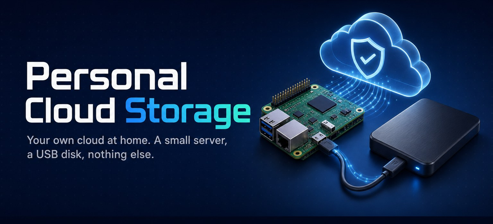

<p align="center">
  
</p>

# Personal Cloud Storage

Nube personal autocontenida: un servidor Linux pequeño (una **Raspberry Pi**, un mini PC o un portátil viejo) con un **HDD USB en exFAT o NTFS**, sin servicios de terceros. Explorador web con subidas reanudables, búsqueda instantánea en subcarpetas, favoritos, papelera, visores, enlaces para compartir, llaves de acceso (passkeys), copia de seguridad en disco externo y acceso remoto privado opcional por Tailscale.

> **Mandato principal:** la ausencia, desconexión o fallo del disco nunca puede interpretarse como un borrado ni producir escrituras en el disco del sistema.

## Funciones

### Archivos

- **Explorador web** para móvil y escritorio: navegar, crear carpetas y archivos de texto, subir, descargar, mover, copiar, duplicar, renombrar y descargar en ZIP (una carpeta entera o una selección).
- **Subidas reanudables** que nunca sobrescriben: si se corta la conexión, siguen desde donde iban. Arrastra archivos o carpetas enteras (a cualquier profundidad). El progreso se ve en el propio listado y en el panel de subidas de la cabecera, con pausa, reanudación y cancelación.
- **Como un explorador de escritorio:** vista de lista o iconos en tres tamaños, orden por nombre, fecha, tamaño o tipo, y barra de herramientas y ruta fijas al hacer scroll. Selección múltiple con Mayús/Ctrl y teclado completo (flechas, Intro, Supr, F2, Ctrl+C/X/V, Ctrl+A, escribir para saltar a un nombre). Arrastrar para mover (Ctrl = copiar) y menú contextual con clic derecho o pulsación larga.
- **Búsqueda en la carpeta y todas sus subcarpetas**, como en Windows o macOS: sin distinguir mayúsculas ni acentos y con varias palabras a la vez. Cada resultado muestra dónde está; los archivos se abren en el visor sin salir de la búsqueda y «Abrir ubicación» lleva hasta el elemento y lo destaca. Se maneja también con el teclado (↓ desde la caja de búsqueda, flechas, Intro).
  - **Al instante aunque haya cientos de miles de archivos:** usa un índice de nombres, como Spotlight o Windows Search ([ADR-0029](docs/adr/0029-indice-de-busqueda.md)). Lo que subes, creas, renombras o mueves desde la web entra al momento, y lo que copian los ordenadores por la carpeta de red, en unos segundos ([ADR-0030](docs/adr/0030-indice-al-dia-con-diarios.md)). Antes de mostrar un resultado se comprueba que sigue en el disco, así que lo borrado no aparece nunca.
- **Renombrar o mover no rompe nada:** los favoritos, los enlaces compartidos, las subidas en curso y la búsqueda siguen al elemento a su sitio nuevo.
- **Panel de detalles** con vista previa, ubicación y **tamaño real de las carpetas**, que también sale en la columna «Tamaño» de la lista. Se calcula por detrás sin bloquear nada.
- **Favoritos:** marca carpetas y archivos con la estrella desde el menú, la barra de selección, el panel de detalles, el título de la carpeta o el visor. El botón ★ muestra solo los favoritos de la carpeta. Están en el Panel y en su propia página (búsqueda, tipo y orden). **Orden personalizado:** arrástralos (en el móvil, mantén pulsado y mueve) y ese orden vale también para el acceso rápido ([ADR-0028](docs/adr/0028-orden-personalizado-favoritos.md)). Abrir un archivo desde ahí y cerrar el visor te devuelve a donde estabas; «Abrir la carpeta» lleva hasta él y lo destaca. Las carpetas favoritas forman el «Acceso rápido» de la barra lateral; con clic derecho se abren o se quitan. Cada cuenta tiene los suyos. Siguen al elemento al renombrarlo o moverlo y nunca se quitan solos si el disco no está ([ADR-0027](docs/adr/0027-favoritos.md)).
- **Papelera** con restauración (también «Deshacer» justo después de eliminar). Se vacía sola pasados 30 días (configurable). El borrado definitivo es solo del propietario y siempre con confirmación.
- **Copiar enlace** a una carpeta o archivo para abrirlo en otro dispositivo de tu red; el archivo se abre directamente en el visor.

### Visores

- Imágenes (con zoom y pellizco), PDF, texto y código, vídeo y audio, sin descargar nada.
- Con ffmpeg y LibreOffice (opcionales), además:
  - imágenes HEIC, TIFF, RAW y más, convertidas por el servidor;
  - vídeo y audio en formatos que el navegador no abre (MKV, AVI, WMV, WMA…), convertidos al vuelo;
  - documentos de Office (Word, Excel, PowerPoint, OpenDocument…), vistos como PDF;
  - miniaturas de fotos y vídeos.
- **Vídeos H.265/HEVC** (iPhone, cámaras): si el navegador sabe reproducirlos (Safari; Chrome, Edge o Firefox con aceleración), se sirve el original sin convertir. Si no, el servidor los convierte a un tamaño que puede reproducir sin cortes. Si la reproducción directa de cualquier vídeo falla, el visor pasa solo a la versión convertida.

### Panel

- **Estado del disco de datos:** espacio libre, formato y avisos al 90 y 95 %. Además, un indicador de copia de seguridad y un resumen de transferencias, acceso y papelera.
- **Recursos del equipo en directo:** CPU, memoria, temperatura, red, disco del sistema y datos del dispositivo. Incluye pruebas de velocidad de la red y del disco.
- **Favoritos** y **Recientes** (lo último subido o creado que sigue existiendo, también lo que copian los ordenadores por la carpeta de red, agrupado por carpeta: [ADR-0024](docs/adr/0024-recientes-de-la-carpeta-de-red.md), [ADR-0025](docs/adr/0025-recientes-agrupa-la-carpeta-de-red.md), [ADR-0026](docs/adr/0026-recientes-versiones-dev-backup-studio.md)).
- **Actividad:** registro de lo que se sube, mueve, elimina, comparte… El propietario ve el de todas las cuentas.

### Compartir

- **Enlaces para invitados sin cuenta** (solo el propietario): un archivo o una carpeta de solo lectura, con caducidad obligatoria (1, 7 o 30 días) y, opcionalmente, contraseña y límite de descargas. Se pueden retirar al instante en Ajustes → Enlaces compartidos.
- Solo se publica una puerta mínima de descarga, en un nodo de Tailscale aparte y **solo mientras hay enlaces activos**. La app nunca queda expuesta a Internet y no se abre ningún puerto del router ([ADR-0018](docs/adr/0018-enlaces-para-invitados.md), [ADR-0019](docs/adr/0019-nodo-tailscale-dedicado-enlaces.md)).

### Cuentas y seguridad

- Cuenta de propietario y cuentas de usuario. El propietario las crea, les cambia la contraseña o las elimina.
- Contraseñas con Argon2id y **llaves de acceso** (Face ID, Touch ID, Windows Hello…). Las sesiones se ven en Ajustes y se pueden cerrar una a una. Todo queda en el registro de auditoría.
- HTTPS en la LAN con CA propia (Caddy). Acceso desde fuera de casa **solo por VPN (Tailscale)**, nunca abierto a Internet, con una guía paso a paso en la propia web ([ADR-0016](docs/adr/0016-acceso-remoto-tailscale.md)).

### Disco y servidor

- `StorageGuardian`: bloquea las escrituras en cuanto el disco desaparece, se cuelga o cambia, y nunca escribe en el mountpoint vacío.
- Los ficheros siguen siendo ficheros normales en el disco: lo conectas a Windows o macOS y los lees tal cual.
- **Trabajo pesado en segundo plano y sin tocar la tarjeta SD:** el índice de búsqueda se construye en un proceso aparte con prioridad mínima de CPU y disco y se guarda en la carpeta interna del propio disco de datos (`.pcloud`). Sin disco no se escribe nada, y si el disco cambia a mitad de la tarea, el resultado se descarta.
- **Copia de seguridad en un disco USB externo**: lo conectas, la nube lo reconoce y sincroniza solo lo nuevo y lo modificado. Lo borrado no se borra de la copia: se aparta con fecha. Al terminar se expulsa solo ([ADR-0017](docs/adr/0017-copia-de-seguridad-disco-externo.md)).
- **Carpeta de red para las copias de tus ordenadores** (opcional): comparte por SMB solo la carpeta `DEV_Backup_Studio`, para que Windows o macOS (por ejemplo con [DEV Backup Studio](#juntos-con-dev-backup-studio)) hagan ahí su copia de seguridad. Cada ordenador se conecta con un botón y un código de 6 cifras, sin contraseñas. Si el disco no está, la conexión se rechaza ([ADR-0021](docs/adr/0021-carpeta-de-red-smb.md), [ADR-0022](docs/adr/0022-emparejar-ordenadores-con-codigo.md)).
- **Reiniciar y apagar el equipo desde Ajustes** (propietario), sin abrir una terminal ([ADR-0020](docs/adr/0020-reiniciar-apagar-desde-la-web.md)).

### App

- **Instalable como app** (PWA) en el móvil y el ordenador, con accesos directos a Archivos, Favoritos y Papelera. En el móvil, barra de pestañas como una app nativa.
- **Interfaz en 7 idiomas:** español, inglés, francés, alemán, italiano, chino simplificado y japonés. Por defecto, el del navegador (si no es ninguno de ellos, inglés); se cambia en Ajustes → Idioma.
- Tema claro y oscuro. La versión instalada se ve en la barra lateral y en Ajustes.

## Juntos con DEV Backup Studio

[DEV Backup Studio](https://github.com/crazyramirez/dev-backup-studio) es una app de escritorio para Windows y macOS que hace copias de seguridad de tus carpetas de proyectos: copia solo lo que ha cambiado, guarda versiones de lo que modificas o borras y comprueba cada archivo con SHA-256. Puede guardar esas copias **en tu nube, por la red de casa**.

Así se suman lo mejor de las dos:

- **Los ordenadores de casa se copian solos en la nube**, sin conectar discos: basta con estar en casa (o en Tailscale). Si la nube está apagada, la app espera y sincroniza en cuanto vuelve.
- **Ves y descargas esas copias desde la web**, en cualquier dispositivo: cada ordenador tiene su carpeta dentro de `DEV_Backup_Studio`, con el icono de DEV Backup Studio.
- **Tres copias sin esfuerzo.** El original en el ordenador, la copia en la nube y, con la copia de seguridad en disco externo, una tercera en otro disco. `DEV_Backup_Studio` entra en ella como cualquier otra carpeta.

Conectarlas es cosa de un minuto, sin escribir direcciones ni contraseñas:

1. Activa la carpeta de red una vez, en el servidor:
   ```bash
   sudo bash /opt/pcloud/current/deploy/linux/setup/pcloud-install-smb.sh --execute
   ```
2. En la web: **Ajustes → Copias de tus ordenadores → Conectar un ordenador**. Aparece un código de 6 cifras, válido 10 minutos y de un solo uso.
3. En DEV Backup Studio ([descargar](https://github.com/crazyramirez/dev-backup-studio/releases/latest)), debajo del destino: **Conectar con mi nube…** La app encuentra la nube en la red; escribe el código y pulsa *Conectar*.

Detalles y seguridad en [OPERATIONS §8 quinquies](docs/OPERATIONS.md#8-quinquies-carpeta-de-red-para-copias-de-los-ordenadores-smb-opcional), [ADR-0021](docs/adr/0021-carpeta-de-red-smb.md) y [ADR-0022](docs/adr/0022-emparejar-ordenadores-con-codigo.md).

## Requisitos

| | Soportado |
|---|---|
| **Sistema** | Linux de 64 bits con systemd. Los scripts de instalación usan `apt`: **Debian 12+, Ubuntu 24.04+ o Raspberry Pi OS 64-bit**. Otras distribuciones: instalando a mano las dependencias. |
| **Arquitectura** | **ARM64** (Raspberry Pi 4/5 y otras SBC) o **x86-64** (mini PC, NUC, portátil, VM con el disco pasado por USB). Sin builds de 32 bits (Node 26). |
| **Disco** | HDD o SSD USB **ya formateado** en exFAT (recomendado) o NTFS. Los scripts nunca formatean. |
| **No soportado como servidor** | Windows y macOS (el guardián lee `/proc/self/mountinfo` y `/sys`). Sirven para desarrollar con el servidor de pruebas. |
| **Docker** | No soportado todavía: dentro de un contenedor la detección de desmontajes ve otro espacio de montajes y está sin validar. |

Hardware de referencia (donde se han hecho las pruebas físicas de desconexión): Raspberry Pi 4B 8 GB, Raspberry Pi OS Lite 64-bit, HDD USB de 2,5" de 5 TB en exFAT. En la Raspberry Pi usa una **fuente oficial** (no una power bank) y, para discos de 2,5" exigentes o de 3,5", un hub o caja con alimentación propia.

## Instalación

### 1. Prepara el equipo y el disco

- **Equipo:** una Raspberry Pi 4/5 con **Raspberry Pi OS Lite de 64 bits** (grábalo con [Raspberry Pi Imager](https://www.raspberrypi.com/software/) y activa SSH), o cualquier PC con Debian o Ubuntu de 64 bits.
- **Disco:** formatéalo en **exFAT** desde Windows o macOS (o usa uno NTFS que ya tengas) y conéctalo. En la Raspberry Pi, al puerto USB 3 (azul).

### 2. Ejecuta un solo comando

Entra en el equipo (por SSH o con teclado y pantalla) y ejecuta:

```bash
curl -fsSL https://raw.githubusercontent.com/crazyramirez/personal-cloud-storage/main/install.sh | sudo bash
```

El instalador lo hace todo y solo te pregunta tres cosas:

1. **Qué disco usar** (lista los discos exFAT/NTFS conectados).
2. Si quieres **visores** de vídeo y documentos de Office (recomendado).
3. Si quieres **acceso desde fuera de casa** con Tailscale (opcional, privado, sin abrir puertos).

Tarda unos 10-20 minutos en una Raspberry Pi (la mayor parte, descargando). Al terminar muestra la dirección y un **código de un solo uso**:

```text
✓ Personal Cloud Storage está instalado.

  Abre en tu navegador:  https://mi-nube.local   (o https://192.168.1.50)
  Código para crear tu cuenta:  ABCDE-FGHIJ-KLMNO-PQRST   (válido 24 h, un solo uso)
```

### 3. Abre la web y crea tu cuenta

Abre esa dirección desde el móvil o el ordenador (en la misma red), pega el código y elige usuario y contraseña. Listo.

> El navegador avisará del certificado la primera vez: es la CA propia de tu nube. Para quitar el aviso, instálala desde `https://<equipo>.local/pcloud-ca.crt` ([cómo](docs/OPERATIONS.md#4-bis-acceso-a-la-web-y-primera-configuración)).

### O pídeselo a un asistente de IA

Si usas un asistente con terminal (Claude Code, Codex CLI, Gemini CLI, Cursor…), puede hacer la instalación entera por ti, desde tu ordenador y por SSH. Pégale esto, cambiando `usuario@equipo` por el tuyo (p. ej. `pi@raspberrypi.local`):

```text
Instala Personal Cloud Storage en mi servidor usuario@equipo siguiendo las instrucciones de
https://raw.githubusercontent.com/crazyramirez/personal-cloud-storage/main/AGENTS.md
```

El asistente comprueba el equipo con `install.sh --check` (solo lectura), te pregunta qué disco usar y si quieres visores y acceso remoto, instala, verifica que todo responde y te da la dirección y el código para crear tu cuenta. Las reglas que sigue están en [AGENTS.md](AGENTS.md): nunca formatea discos, nunca te pide contraseñas (si `sudo` la necesita, te da el comando para que lo pegues tú) y nunca abre el servidor a Internet. Con el repositorio clonado, en Claude Code basta con `/instalar usuario@equipo`.

Un chat sin terminal (ChatGPT, Gemini o Claude en la web) también puede guiarte con el mismo enlace: tú ejecutas los comandos y le pegas la salida.

### Qué hace el instalador (y qué no)

- Descarga la última [release](https://github.com/crazyramirez/personal-cloud-storage/releases) y comprueba su SHA-256.
- Instala Node.js, Caddy (HTTPS) y el servicio `pcloud`, ejecuta las pruebas en tu propio equipo y solo entonces activa la aplicación.
- Monta el disco en `/srv/pcloud` y protege esa carpeta: si el disco se desconecta, nada se escribe en la tarjeta SD.
- **Nunca formatea, particiona ni borra nada del disco.** Solo crea las carpetas `data` (tu nube) y `.pcloud` (uso interno); lo que ya hubiera queda intacto.
- No abre puertos a Internet.

### Actualizar, añadir el disco más tarde o reparar

Vuelve a ejecutar **el mismo comando**. Es idempotente: no repite lo que ya está hecho, instala la versión nueva si la hay (con vuelta atrás automática si falla) y, si no había disco, te deja elegirlo.

### Opciones

Para instalar sin preguntas o automatizarlo, pasa opciones tras `bash -s --`:

```bash
curl -fsSL https://raw.githubusercontent.com/crazyramirez/personal-cloud-storage/main/install.sh | sudo bash -s -- --yes --viewers --disk 1A2B-3C4D
```

| Opción | Efecto |
|---|---|
| `--yes` | Sin preguntas: visores sí, Tailscale no, disco solo si hay uno compatible |
| `--disk UUID` / `--no-disk` | Usar ese disco (`lsblk -f` muestra el UUID) / no configurar disco ahora |
| `--viewers` / `--no-viewers` | Instalar o no ffmpeg + LibreOffice |
| `--tailscale` / `--no-tailscale` | Activar o no el acceso remoto privado |
| `--version v0.1.0` | Instalar una versión concreta |
| `--from-source` | Compilar desde un clon del repositorio (`git clone … && sudo bash install.sh --from-source`) |
| `--upgrade-system` | Aplicar también las actualizaciones pendientes del sistema |
| `--check` | Solo diagnosticar, sin cambiar nada ni pedir root: sistema, instalación y discos compatibles en formato `clave=valor` |

Instalación paso a paso, runbooks (desconexiones, cambio de disco) y detalles: [docs/OPERATIONS.md](docs/OPERATIONS.md).

> ⚠️ El disco de la nube **no es una copia de seguridad**: si falla, se pierden los datos. Usa la copia en disco externo (Ajustes → Copia de seguridad) o ten otra copia de lo que te importe.

## Documentación

| Pieza | Ubicación |
|---|---|
| Auditoría de la spec (contradicciones, riesgos, decisiones pendientes) | [docs/SPEC_AUDIT.md](docs/SPEC_AUDIT.md) |
| Datos de hardware que hay que verificar | [docs/HARDWARE_DISCOVERY.md](docs/HARDWARE_DISCOVERY.md) |
| Decisiones de arquitectura | [docs/adr/](docs/adr/README.md) |
| Contrato de almacenamiento (estados, leases, invariantes) | [docs/STORAGE_CONTRACT.md](docs/STORAGE_CONTRACT.md) |
| Roadmap por sprints | [docs/ROADMAP.md](docs/ROADMAP.md) |
| `StorageGuardian` + tests | [apps/server/src/storage/](apps/server/src/storage/), [apps/server/test/](apps/server/test/) |
| API (Fastify), auth, subidas | [apps/server/src/http/app.ts](apps/server/src/http/app.ts), [apps/server/src/storage/uploads.ts](apps/server/src/storage/uploads.ts) |
| Web (Nuxt, SPA estática) | [apps/web/](apps/web/) |
| Servicio systemd y Caddy | [deploy/linux/systemd/](deploy/linux/systemd/), [deploy/linux/caddy/](deploy/linux/caddy/) |
| Scripts de diagnóstico (solo lectura) | [deploy/linux/diagnostics/](deploy/linux/diagnostics/) |
| Protección del mountpoint (dry-run por defecto) | [deploy/linux/setup/pcloud-mountpoint-guard.sh](deploy/linux/setup/pcloud-mountpoint-guard.sh) |
| Instalación del servidor y despliegue por releases | [deploy/linux/setup/](deploy/linux/setup/), [deploy/dev/pack-release.sh](deploy/dev/pack-release.sh) |
| Operación del servidor | [docs/OPERATIONS.md](docs/OPERATIONS.md) |
| Instrucciones para asistentes de IA (instalación guiada, reglas) | [AGENTS.md](AGENTS.md) |
| Laboratorio F0 con exFAT real en RAM | [tests/fault-injection/](tests/fault-injection/README.md) |

## Estructura

```text
apps/server/          API (Fastify) + StorageGuardian + configuración + CLIs de operación
apps/web/             Web (Nuxt 4, SPA estática con CSP por hashes)
packages/contracts/   Esquemas TypeBox y tipos de la API v1 compartidos con web/desktop
deploy/config/        config.example.yaml
deploy/linux/         diagnóstico, setup y check-scripts.sh
docs/                 auditoría, ADRs, contratos, roadmap
tests/fault-injection Protocolos de pruebas físicas
```

`apps/desktop`, `packages/sdk`, `packages/ui` y `packages/sync-core` se crean en su fase.

## Desarrollo

Requisitos: Node 26 LTS. pnpm 12 (sin instalación global: `npx pnpm@12.18.0`).

```bash
npx pnpm@12.18.0 install
npx pnpm@12.18.0 typecheck      # tsc 7, solo comprobación de tipos
npx pnpm@12.18.0 test           # node --test
npx pnpm@12.18.0 check:scripts  # bash -n, LF y comandos prohibidos
```

Probar la interfaz sin servidor (API real sobre un volumen temporal; `/__dev/disconnect` y `/__dev/reconnect` simulan el disco):

```bash
(cd apps/web && npx pnpm@12.18.0 run generate)
node apps/server/test/support/dev-server.ts 3999       # http://127.0.0.1:3999, imprime el código de configuración
```

El servidor se ejecuta directamente desde TypeScript (type stripping de Node, [ADR-0001](docs/adr/0001-monorepo-pnpm-typescript-nativo.md)); no hay paso de build.

## En el servidor

Instalación, despliegue por releases, rollback y comprobaciones: [docs/OPERATIONS.md](docs/OPERATIONS.md).

```bash
bash deploy/dev/pack-release.sh                                   # en desarrollo (compila también la web)
sudo bash /opt/pcloud/current/deploy/linux/setup/pcloud-deploy-release.sh install /tmp/pcloud-*.tar.gz
pcloud-volume-status [--uuid <UUID>] [--watch 1]                  # veredicto del guardián (solo lectura)
```

Ningún script de este repositorio formatea, particiona, repara ni borra datos del HDD.

## Licencia

[MIT](LICENSE). Especificación original: [docs/SPEC.md](docs/SPEC.md).
