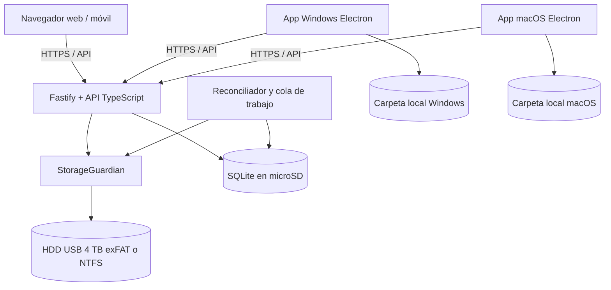

# PERSONAL CLOUD STORAGE — Especificación técnica y plan de desarrollo

**Estado:** Documento de arquitectura v1.0 (13 de noviembre de 2026)  
**Destino:** Desarrollo con Claude  
**Objetivo:** NAS/nube personal sobre Orange Pi Zero 2W, Ubuntu, microSD de 64 GB y HDD USB de 4 TB en **exFAT o NTFS**, con panel web propio y clientes de escritorio Windows/macOS posteriores.

> **Mandato principal:** conservar la integridad de los datos. La ausencia, desconexión o fallo del disco NUNCA puede interpretarse como eliminación masiva de archivos ni producir escrituras accidentales en la microSD.

---

## 1. Visión de producto

Crear un producto personal autocontenido, sin Nextcloud, ownCloud, servicios cloud obligatorios, cuentas de terceros, telemetría ni dependencias SaaS. Su objetivo es ofrecer:

1. Explorador de archivos web similar a Synology Drive / Dropbox: carpetas, búsqueda, navegación, carga, descarga, sustitución y organización.
2. Acceso seguro desde la red local y, en una fase posterior, mediante acceso remoto privado.
3. Gestión segura de un HDD USB de 4 TB, con reconocimiento de exFAT y NTFS sin reformateo obligatorio.
4. Cargas grandes reanudables y descargas parciales, usando streaming y memoria limitada.
5. Papelera, control de versiones opcional, auditoría y supervisión del disco.
6. Fase II: app Windows/macOS con explorador remoto, cola de transferencias, carpetas favoritas y sincronización opcional bidireccional.
7. Arquitectura escalable a otra SBC, mini-PC o NAS en el futuro, sin que los datos queden cautivos de un formato propietario.

**Fuera de alcance inicial:** servidor multimedia con transcodificación, edición colaborativa Office, RAID, indexación OCR masiva, IA local, deduplicación de bloques de todo el disco y sincronización de 4 TB en tiempo real. Son características potenciales posteriores, no requisitos del MVP.

### Principios no negociables

- Los archivos físicos son archivos y carpetas normales, legibles directamente desde Windows/macOS cuando el formato lo permita.
- No sobrescribir, reformatear, reorganizar ni borrar archivos existentes al conectar el HDD.
- La base de datos es un **índice reconstruible** y un registro de operaciones; nunca la única copia de datos críticos.
- Seguridad por defecto: un usuario propietario inicial, acceso mínimo y sin puertos expuestos a Internet.
- Cualquier operación destructiva debe comprobar explícitamente que el volumen esperado está montado, disponible y escribible.
- La sincronización nunca es una copia de seguridad. Se exige estrategia de backup independiente para información importante.
- Priorizar implementaciones simples y auditables sobre microservicios y abstracciones prematuras.

---

## 2. Hardware objetivo y límites

| Elemento | Situación / criterio |
|---|---|
| Placa | Orange Pi Zero 2W, SoC Allwinner H618 ARM64. **Verificar RAM exacta**. |
| Sistema operativo | Ubuntu ya instalado. Verificar versión, kernel y arquitectura, no presuponer release. |
| Disco sistema | microSD 64 GB; mantener aquí aplicación, configuración, SQLite y logs rotados. |
| Disco datos | HDD USB 4 TB, partición preexistente exFAT **o** NTFS. |
| USB | La familia Zero 2W emplea USB 2.0 para datos; verificar conexión real con `lsusb -t`. |
| Red | Wi-Fi 5 o adaptador/expansión Ethernet 100 Mb/s, según montaje. Medir red real. |
| Alimentación | HDD 3,5" con fuente independiente; HDD 2,5" mediante carcasa/hub USB alimentado si no se garantiza corriente suficiente. No confiar en el puerto de la SBC como fuente de potencia para un HDD sin comprobar. |

**Rendimiento de referencia, NO garantía:** USB 2.0 impone 480 Mb/s teóricos compartidos; el rendimiento útil suele ser bastante menor. Una conexión Ethernet de 100 Mb/s tiene un máximo teórico de 12,5 MB/s y habitualmente menor en transferencia real. Wi-Fi depende del entorno. Medir antes de fijar objetivos de throughput.

No construir el frontend de producción en la Orange Pi: compilar en un ordenador de desarrollo, distribuir los archivos estáticos y ejecutar solo los procesos imprescindibles en la placa.

### Comandos de inventario (solo lectura)

```bash
uname -a
cat /etc/os-release
uname -m
free -h
lsblk -o NAME,SIZE,FSTYPE,UUID,LABEL,MOUNTPOINTS,MODEL,TRAN
lsusb -t
ip -br address
df -hT
cat /proc/filesystems | grep -E 'exfat|ntfs3|fuseblk' || true
```

Completar un documento `docs/HARDWARE_DISCOVERY.md` con resultados reales antes de escribir scripts de montaje.

---

## 3. Decisión clave: exFAT y NTFS

El sistema **NO** debe depender de atributos POSIX, propietarios por archivo, enlaces simbólicos, hard links, ACL Linux, inotify perfecto, snapshots del filesystem, reflinks ni atributos extendidos para su funcionamiento normal.

| Criterio | exFAT | NTFS |
|---|---|---|
| Lectura/escritura en Ubuntu | Controlador exfat del kernel, si está disponible | Preferencia: `ntfs3` del kernel si la versión y las pruebas lo permiten; fallback evaluable: `ntfs-3g` |
| Conectar directamente a Windows | Sí | Sí |
| Conectar directamente a macOS | Sí | Habitualmente lectura nativa; escritura no garantizada sin herramientas adicionales |
| Permisos Unix | No nativos; se simulan con opciones de montaje | Comportamiento dependiente del controlador y opciones; no asumir ACL POSIX equivalentes |
| Journaling | exFAT convencional no dispone de journaling habitual | NTFS posee diario; `ntfs3` admite replay, pero no garantiza todas las propiedades de journaling Linux |
| Riesgo tras corte/desconexión durante escritura | Más alto | Menor en algunos escenarios, pero nunca cero |

**Selección:**

- Si se requiere retirar el disco y conectarlo directamente a Windows y macOS: preferir **exFAT**, asumiendo la necesidad de alimentación fiable, expulsión segura y backup.
- Si el disco va a quedar dedicado a la Orange Pi y se desea compatibilidad directa con Windows: preferir **NTFS** si el kernel/driver supera pruebas de carga, remontaje y recuperación.
- Si el disco ya contiene datos: **respetar el formato existente**. Jamás reformatear desde los scripts de instalación.
- Aunque sea técnicamente más natural en Linux, **ext4 no forma parte de los requisitos de formato del HDD**. Solo se aprovecha el filesystem Linux existente de la microSD para el estado interno.

### 3.1. Regla de nombres portable

El backend impondrá una política estricta de nombres válida para sincronizar entre Windows/macOS:

- Prohibir `\\ / : * ? " < > |`, caracteres de control, segmentos vacíos, `.` y `..`.
- Rechazar nombres reservados de Windows (`CON`, `PRN`, `AUX`, `NUL`, `COM1..COM9`, `LPT1..LPT9`, incluyendo sus extensiones).
- Rechazar nombres terminados en espacio o punto.
- Normalizar Unicode a NFC para comparación lógica y documentar la representación real; no renombrar masivamente archivos existentes por defecto.
- Detectar colisiones por case-folding y Unicode entre plataformas, aunque Linux exponga nombres que difieran.
- Validar longitud por componente y ruta, con pruebas de límites reales del volumen/montaje.
- No seguir symlinks/reparse points; no admitirlos en sincronización inicial.
- Importar archivos con nombres incompatibles como **solo lectura y señalizados**, o proponer un renombrado explícito. Nunca corregir nombres en silencio.

### 3.2. Estructura física de los archivos

El HDD se monta **completo** en `/srv/pcloud` y el espacio administrado reside en una carpeta `data/`. Si existen carpetas previas en la raíz, el usuario puede incorporarlas a través de una operación de importación no destructiva.

```text
/srv/pcloud/                  # PUNTO DE MONTAJE; no guardar nada aquí sin montar
├── data/                     # raíz de archivos administrados
│   ├── Documentos/
│   ├── Proyectos/
│   ├── Fotografias/
│   └── ...
└── .pcloud/                  # archivos operativos en el MISMO HDD
    ├── staging/              # carga temporal de archivos grandes
    ├── trash/                # papelera física
    ├── versions/             # versiones opcionales (consumen espacio real)
    └── volume-id             # identificador propio de volumen, creado tras vincularlo
```

**Importante:** la carpeta `data/` no implica mover automáticamente todos los archivos preexistentes. Durante onboarding, la UI debe ofrecer: (a) empezar vacío en `data/`; (b) importar una carpeta concreta; (c) administrar una raíz existente bajo políticas explícitas. No usar enlaces simbólicos para encubrir esta diferencia.

La ruta de estado interno en la microSD:

```text
/opt/pcloud/                  # binarios / app desplegada
/etc/pcloud/config.yaml       # configuración (root:service o acceso estricto)
/var/lib/pcloud/
├── database/pcloud.sqlite    # SQLite, WAL solo sobre filesystem Linux local
├── secrets/                  # credenciales cifradas/secretos, permisos 0700
├── locks/
└── snapshots-db/             # snapshots transitorios; copiar después a otro soporte
/var/log/pcloud/              # journald preferido; rotación y límites
```

### 3.3. Montaje seguro

No ejecutar `mkfs`, `parted`, `wipefs` ni `dd` en el asistente normal. Primero obtener `lsblk -f` y UUID. Crear usuario de servicio `pcloud` con UID/GID reales descubiertos. Emplear UUID, nunca depender del nombre `/dev/sda1`.

**Ejemplos de plantillas, NO copiar sin adaptar y probar en el kernel real:**

```fstab
# ExFAT — sustituir UUID, UID y GID reales
UUID=<UUID_REAL> /srv/pcloud exfat rw,nofail,noatime,nodev,nosuid,noexec,uid=<UID>,gid=<GID>,fmask=0177,dmask=0077,errors=remount-ro 0 0

# NTFS — usar SOLO UNA línea, y únicamente si ntfs3 está probado
UUID=<UUID_REAL> /srv/pcloud ntfs3 rw,nofail,noatime,nodev,nosuid,noexec,uid=<UID>,gid=<GID>,fmask=0177,dmask=0077,windows_names 0 0
```

En sistemas `ntfs3` antiguos comprobar si `windows_names` está disponible; adaptar la plantilla al resultado real. Antes de habilitar arranque automático: `findmnt --verify`, montaje manual, pruebas de lectura/escritura, desmontaje limpio y reinicio. Nunca montar a la fuerza un NTFS marcado dirty/hibernado. Si el volumen está dañado, bloquear escritura y mostrar instrucciones de recuperación; `ntfsfix` NO sustituye `chkdsk` de Windows. Para exFAT, utilizar herramientas `exfatprogs` **sobre volumen desmontado** y previo backup cuando sea posible.

### 3.4. Detector de volumen / anticatástrofes

Implementar un `StorageGuardian` obligatorio, invocado por **cada** operación de escritura, borrado, reemplazo, limpieza de staging y sincronización:

1. Comprobar que `/srv/pcloud` es un punto de montaje real; no basta con `fs.existsSync`.
2. Identificar el origen real mediante `/proc/self/mountinfo`, `findmnt` o API equivalente verificada; debe coincidir con UUID configurado.
3. Confirmar que el volumen contiene el identificador esperado (`.pcloud/volume-id`) y que coincide con el registro local; un marcador copiado por sí solo no sustituye el UUID.
4. Comprobar si el montaje es read-only, un fallo I/O o el disco se ha desconectado.
5. Revalidar inmediatamente antes de confirmar una mutación y detectar cambios de generación/montaje.
6. En estado `UNAVAILABLE`, `READ_ONLY`, `UNHEALTHY` o `WRONG_VOLUME`: **rechazar todas las mutaciones**.
7. La API puede seguir disponible y mostrar estado del servidor, pero debe devolver `503 STORAGE_UNAVAILABLE` para operaciones sobre archivos.
8. No crear `data/`, `.pcloud/` ni `staging/` sobre el mountpoint vacío de la microSD. Instalar un guard adicional de escritura para la raíz del montaje.
9. No ejecutar purgas o reindexaciones destructivas al recuperar el disco; primero reconciliar el diario.

Estados expuestos por la API: `INITIALIZING`, `READY`, `READ_ONLY`, `UNAVAILABLE`, `WRONG_VOLUME`, `NEEDS_CHECK`, `SCANNING`.

Prueba obligatoria: desconectar el HDD físicamente durante una transferencia y observar que ni se borra nada local/remoto ni aparecen archivos en la microSD bajo `/srv/pcloud`.

---

## 4. Stack tecnológico

| Capa | Implementación | Razón |
|---|---|---|
| Web | **Nuxt + Vue + TypeScript + CSS** | Stack conocido; componentes reutilizables en desktop. |
| Web en producción | **SPA estática** (Nuxt `ssr: false`, build y despliegue de assets) | No ejecutar SSR/Nitro dedicado en la SBC si no aporta valor. |
| Backend | **Node.js LTS + TypeScript + Fastify** | Alto rendimiento I/O, streaming y API compacta; un solo proceso gestionado por systemd. |
| Validación | Zod o JSON Schema con validación estricta | API tipada y nombres/rutas seguros. |
| DB local | **SQLite en ext4/local Linux** | Usuario, índices, operaciones, sesiones, cursores de sync. WAL con checkpoints controlados. |
| Acceso a disco | `node:fs`, streams y API del SO | Sin abstracciones de almacenamiento cloud. |
| Procesos | `systemd` | Reinicio, límites, logs y servicio sin privilegios. |
| Proxy HTTPS | Opcional Caddy/Nginx, en capa de despliegue | TLS y cabeceras; no obligatorio para núcleo lógico. |
| Clientes escritorio | **Electron + Nuxt/TS** | Conocimiento existente, compartir UI y Node sync engine. |
| Servicios Python | **Ninguno inicialmente** | Incorporar solo si una función concreta demuestra necesidad. |

Dependencias de terceros permitidas si reducen riesgos evidentes: Fastify, librería SQLite, validación, hashing/crypto estándar, procesador de imágenes opcional, librería watcher, Electron. Evitar contenedores, colas externas, Redis, Elasticsearch, MinIO, Docker y Kubernetes en el MVP.

En ARM64, verificar soporte de bindings nativos SQLite; compilarlos para la arquitectura concreta o usar una API SQLite mantenida compatible con el Node escogido. Documentar versiones fijadas (lockfile) y SBOM básico.

### 4.1. Topología



La app cliente debe transferir bloques directamente por streams HTTP; el backend no almacenará ficheros completos en RAM. El navegador y los clientes utilizan una sola API versionada.

---

## 5. Monorepo y estructura de código

```text
personal-cloud/
├── apps/
│   ├── web/                  # Nuxt UI, build estático
│   ├── server/               # Node TS + Fastify + servicios
│   └── desktop/              # Electron Win/macOS; fase II
├── packages/
│   ├── contracts/            # contratos de API, validadores, tipos
│   ├── sdk/                  # cliente HTTP, auth, transfers
│   ├── sync-core/            # motor sync cross-platform; fase II
│   ├── ui/                   # componentes Nuxt/Vue reutilizables
│   └── common/               # normalización y errores comunes
├── deploy/
│   ├── systemd/
│   ├── linux/
│   └── reverse-proxy/
├── docs/
│   ├── HARDWARE_DISCOVERY.md
│   ├── ARCHITECTURE.md
│   ├── STORAGE_CONTRACT.md
│   ├── API.md
│   ├── SECURITY.md
│   ├── SYNC_PROTOCOL.md
│   ├── OPERATIONS.md
│   ├── BACKUP_RESTORE.md
│   └── TEST_PLAN.md
├── tests/
│   ├── integration/
│   ├── contract/
│   ├── e2e/
│   └── fault-injection/
├── .env.example
├── pnpm-workspace.yaml
└── README.md
```

Se podrá simplificar la estructura mientras solo exista la fase I, pero conservar `contracts` y el SDK para evitar duplicar la lógica en Windows/macOS.

---

## 6. Modelo de datos (SQLite)

Tablas mínimas (campos orientativos, sujetos a migraciones):

| Tabla | Campos esenciales | Uso |
|---|---|---|
| `users` | id, username, password_hash, role, created_at, disabled_at | Propietario y futuros usuarios. |
| `sessions` | id, user_id, secret_hash, expires_at, created_at, revoked_at | Sesión web; invalidación explícita. |
| `devices` | id, owner_id, name, platform, secret_hash, last_seen, revoked_at | Vinculación desktop. |
| `volumes` | id, fs_uuid, fs_type, marker_uuid, mount_path, state, last_seen | Identidad del HDD, montaje y alarmas. |
| `files` | id, volume_id, parent_id, relpath, display_name, type, size_bytes, mtime_ns, fingerprint, sha256_nullable, scan_generation, updated_at | Índice de archivos; `id` lógico estable para operaciones gestionadas por API. |
| `change_log` | seq INTEGER PRIMARY KEY, volume_id, item_id, action, revision, relpath, previous_path_nullable, timestamp | Feed incremental de cambios para clientes. |
| `operations` | id, type, file_id, state, source, destination, started_at, completed_at, error | Diario recuperable; reconciliación tras crash. |
| `uploads` | id, owner_id, target_path, temp_path, expected_bytes, received_bytes, expected_sha256, state, expires_at | Transferencias reanudables. |
| `trash_items` | id, original_path, stored_path, deleted_at, retention_until, size_bytes | Restauración de borrados. |
| `versions` | id, file_id, revision, stored_path, size_bytes, created_at | Historial opcional, con cuota. |
| `sync_roots` | id, device_id, local_root_fingerprint, remote_root_id, direction, status | Carpeta sincronizada, fase II. |
| `sync_clients` | device_id, last_acked_seq, last_success_at | Cursor confirmado por dispositivo. |
| `audit_log` | id, actor_id, device_id, action, path, result, timestamp, ip | Auditoría básica; nunca almacenar contenidos ni contraseñas. |

**Reglas:**

- Generar migraciones reversibles cuando sea posible; snapshots de DB antes de cambios de esquema.
- SQLite con WAL sobre filesystem local soportado, jamás sobre exFAT/NTFS externo en este proyecto.
- `size_bytes` y secuencias de cambios deben manejarse con enteros seguros; si se serializan como strings para contratos abiertos, documentarlo.
- `relpath` es relativo al directorio autorizado; no almacenar rutas físicas arbitrarias enviadas por el cliente.
- No confiar solo en `mtime`: combinar tamaño/mtime y hash SHA-256 cuando exista una modificación relevante. Hash perezoso para evitar recorrer 4 TB continuamente.
- Si cambia un archivo directamente desde otro sistema, el reconciliador debe actualizar el índice sin inventar una operación de API que no ocurrió.
- Si se pierde la DB, el contenido del HDD sigue existiendo. Reconstruir índice, pero avisar que dispositivos, cursores y versiones lógicas pueden requerir restauración del backup de metadatos.
- Mantener WAL y logs bajo control; agrupar escrituras y configurar backups periódicos para no castigar la microSD.

### 6.1. Estrategia de indexación

- Escaneo inicial no destructivo, por lotes, de baja prioridad y con progreso.
- Navegación inmediata con lectura de directorios a demanda mientras se crea el índice.
- Watchers como aceleración, **nunca fuente única de verdad**; reescaneo periódico de reconciliación.
- Limitar concurrencia y suspender hash/miniaturas ante transferencias intensivas.
- Gestionar cambios externos después de desmontar/reconectar, no tratarlos como borrado masivo mientras el volumen falte.
- Ficheros internos `.pcloud` y recursos propios excluidos de indexación y sync.

---

## 7. Operaciones de archivos y consistencia

### 7.1. Contrato de rutas

- API trabaja con ID de archivo o ruta relativa normalizada, nunca con paths absolutos del host.
- Resolver dentro del directorio de datos autorizado, verificar límites de directorio y deshabilitar symlinks/reparse points en fase I.
- La validación `startsWith(root)` es insuficiente: usar resolución por componentes, descriptor de fichero y verificaciones contra condiciones de carrera, cuando la plataforma lo permita.
- Autorizar por usuario, volumen y raíz antes de tocar disco.
- Todas las operaciones destructivas se rechazan en estado no `READY`.

### 7.2. Escritura segura de archivo

1. Autenticación, autorización, reserva de destino y validación de nombre/cuota.
2. `StorageGuardian.assertWritableVolume()`.
3. Crear upload staging **en el HDD** (`.pcloud/staging/<uuid>.part`); nunca usar microSD para el archivo completo.
4. Escribir bytes por streaming con límites de tamaño y backpressure.
5. Validar longitud total y SHA-256 cuando el cliente lo proporciona; revalidar volumen.
6. Para sustituciones: registrar intención y conservar versión anterior según política, sin renunciar a la recuperación ante fallos.
7. Sincronizar datos del temporal en la medida soportada por el FS y renombrar dentro del mismo volumen; no presuponer durabilidad absoluta de `fsync` en exFAT/NTFS ni atomicidad perfecta ante pérdida de energía.
8. Marcar operación completada en SQLite y publicar cambio con secuencia monotónica.
9. Reconciliar automáticamente `PREPARING`, `STAGED`, `COMMITTING` después de un reinicio; nunca borrar automáticamente el único ejemplar íntegro.

**Sobrescrituras:** antes de reemplazar, validar versión remota esperada (`If-Match` o revision). En conflicto, responder `409 CONFLICT` y ofrecer conservar ambos. La historia de versiones consume capacidad física, no snapshots gratis en exFAT/NTFS.

### 7.3. Papelera, versiones, espacio

- Borrar equivale por defecto a mover a `.pcloud/trash/` del mismo HDD, indexado en DB.
- Papelera con retención configurable, por defecto 30 días; ninguna purga sin control de volumen y cuota.
- Versionado **desactivado o conservador inicialmente**, activable por carpeta y con máximo de versiones/GB; grandes archivos pueden duplicar físicamente su tamaño.
- Reservar margen configurable de espacio libre (propuesta 2% del volumen, con límite inferior razonable), bloquear subidas cuando quede poco espacio.
- Verificar la cuota antes y durante transferencias, no solo al inicio.
- Una operación que falla no deja ficheros finales incompletos con nombre definitivo.

### 7.4. Descargas

- HTTP Range (`206 Partial Content`), `Content-Disposition` correcto para Unicode, headers de tamaño y ETag/revisión.
- Streaming directo desde el disco, con cancelación y reanudación del cliente.
- Protección contra solicitar rangos abusivos, límites por usuario y log de transferencias.
- No comprimir por defecto multimedia y ZIP ya comprimidos.

---

## 8. API REST v1

Base: `/api/v1`; JSON en metadatos, bytes binarios en transferencias.

### Auth / sistema

```text
POST   /auth/login                 # sesión web segura
POST   /auth/logout
GET    /auth/me
POST   /auth/devices/pair/start   # fase II: código temporal
POST   /auth/devices/pair/finish
GET    /system/health
GET    /system/storage            # volumen esperado/real, FS, espacio, SMART si disponible
GET    /system/activity
```

### Exploración y archivos

```text
GET    /files?parentId=&cursor=&limit=&sort=
GET    /files/:id
GET    /files/:id/download       # Range, ETag
POST   /folders                 # create
PATCH  /files/:id               # rename/move con expectedRevision
DELETE /files/:id               # mover a papelera, no purge
POST   /files/:id/copy
GET    /files/search?q=&cursor=
GET    /trash
POST   /trash/:id/restore
DELETE /trash/:id                # purge explícita + confirmación
GET    /files/:id/versions
POST   /files/:id/versions/:versionId/restore
```

### Carga reanudable

```text
POST   /uploads                 # init {parentId,name,size,sha256?,overwriteRevision?}
HEAD   /uploads/:uploadId       # estado/offset recibido
PATCH  /uploads/:uploadId       # bytes con offset/token; idempotencia
POST   /uploads/:uploadId/complete
DELETE /uploads/:uploadId       # cancelar
```

Diseñar cargas por offset confirmado y/o chunks numerados con hashes individuales, pero **escoger una sola variante para MVP**, implementarla de extremo a extremo y probar corte de conexión. Sugerencia inicial: chunks de 4-8 MiB y concurrencia 1-2 por servidor, configurable. El frontend debe gestionar pausa, reintento exponencial, resume y cancelación.

### Sincronización (contrato preparado en fase I; cliente en fase II)

```text
GET    /sync/changes?cursor=<seq>&limit=500
POST   /sync/ack             # deviceId + último seq aplicado
POST   /sync/compare         # revisión remota / fingerprint
POST   /sync/operations      # lote de movimientos/borrados, con idempotency key
```

Documentar errores estándar:

```json
{
  "error": {
    "code": "STORAGE_UNAVAILABLE",
    "message": "El disco configurado no está disponible",
    "requestId": "...",
    "retryable": true
  }
}
```

Códigos importantes: `401`, `403`, `404`, `409`, `412`, `413`, `423`, `429`, `503`, `507`. Cada mutación debe aceptar una clave de idempotencia cuando pueda repetirse por mala conexión.

---

## 9. Panel web Nuxt: experiencia de usuario

### Diseño

- Interfaz profesional, sobria, responsive: barra lateral, área principal, barra superior y panel de detalles.
- Referencia visual funcional de un gestor de archivos moderno, **no copiar marcas, logos ni assets de Synology/Dropbox**.
- Tema claro y oscuro; CSS propio; iconografía consistente; estados cargando/vacío/error.
- Construir como SPA estática y mantener componentes reutilizables para Electron.

### Pantallas mínimas

1. **Setup inicial:** estado Orange Pi, volumen detectado, FS, espacio, importación no destructiva, creación del propietario, prueba de escritura controlada.
2. **Dashboard:** capacidad ocupada/libre, espacio en papelera/versiones, transferencia actual, salud básica del disco, red, actividad.
3. **Explorador:** lista/cuadrícula, breadcrumbs, orden por nombre/tamaño/fecha, búsqueda, múltiples selecciones, arrastrar y soltar.
4. **Visor:** fotos e imágenes; PDF y texto plano cuando navegador lo soporte; vídeo con Range sin transcodificación. No prometer compatibilidad universal de códecs.
5. **Transferencias:** cola, porcentaje, velocidad, pausa/reanudar, historial y errores reintentables.
6. **Papelera:** restauración y eliminación definitiva deliberada.
7. **Actividad:** qué archivo cambió, cuándo, desde qué dispositivo, éxito/error.
8. **Ajustes:** nombre servidor, seguridad, política de versiones, límites, exploración, sistema de archivos, almacenamiento.
9. **Pantalla de fallo de HDD:** claramente diferenciada de directorio vacío; operaciones bloqueadas.

### Comportamiento imprescindible

- Cargar listados paginados; jamás enviar 100.000 entradas de una sola vez.
- Progreso por fichero y global; velocidades calculadas con ventana móvil sin render excesivo.
- Confirmación previa a sobrescritura y borrados.
- Evitar re-render masivo, miniaturas limitadas y lazy loading.
- Mostrar que el producto es **una nube sobre un disco físico USB**, con indicadores transparentes de disponibilidad.

---

## 10. App de escritorio — Fase II

Desarrollar **Electron + Nuxt/TypeScript** para Windows 10/11 y macOS soportados. Compartir con la web `packages/ui`, `packages/contracts` y `packages/sdk`. La UI corre en Electron renderer; el trabajo de sincronización/disco en proceso main o worker dedicado, **nunca** en el renderer.

### 10.1. Primera versión desktop: Remote Explorer

- Conectar al servidor mediante URL HTTPS o descubrimiento LAN opcional.
- Vinculación segura mediante código de un solo uso con expiración.
- Guardar tokens en almacén del SO (DPAPI/Keychain usando API apropiada, por ejemplo Electron `safeStorage` cuando sea suficiente).
- Navegación remota inmediata, búsqueda, arrastrar/soltar hacia y desde el ordenador.
- Descargar a carpeta seleccionada, subir archivos, reemplazar con confirmación, ver estado del HDD.
- Carpetas favoritas, archivos recientes y transferencias en background.
- Caché solo de **metadatos y miniaturas limitadas**, no copia automática de 4 TB.
- Bandeja de sistema/menu bar, inicio opcional con SO, notificaciones de transferencias.

### 10.2. Segunda versión desktop: sincronización de carpetas

Modos por carpeta, configurables de forma individual:

1. **Solo exploración remota:** no se copia nada automáticamente.
2. **Solo descarga:** servidor → carpeta local.
3. **Backup/subida:** carpeta local → servidor (sin aplicar borrado remoto por defecto).
4. **Sincronización bidireccional:** cambios en ambos lados, con reglas de conflicto y borrado.

**Protocolo propuesto:**

- Cada dispositivo se identifica con `deviceId` único y cada carpeta con `syncRootId` estable.
- Guardar SQLite local con el estado de cada elemento: ruta normalizada, tamaño, mtime, fingerprint/hash, revisión remota, última revisión sincronizada y tombstones.
- Watchers Windows/macOS para latencia baja, pero siempre complementados por escaneo de reconciliación.
- **No detectar borrados a partir de la ausencia durante un disco offline, error de lectura, carpeta inaccesible o root local desaparecida.**
- Cursor remoto monotónico desde `/sync/changes`; garantizar paginación, reintentos y re-scan ante cursor caducado.
- Si cambian ambos extremos desde la última sincronización: crear copia de conflicto con sufijo de dispositivo/fecha; no sobrescribir silenciosamente.
- Si una app cliente lleva mucho tiempo sin conectarse, pedir full reconciliation sin borrar por defecto.
- Propagar borrados solo en modo bidireccional activado explícitamente y tras verificación de raíz, volumen y cambios conocidos.
- Al detectar borrado masivo sospechoso (porcentaje y número de ficheros configurables), detener cola y solicitar confirmación.
- Mover/renombrar: operación lógica cuando se pueda rastrear; si no, tratar conservadoramente como nuevo + borrado con control.
- Archivos abiertos o bloqueados: reintentos programados, no perder trabajo; conflictos visibles al usuario.
- No sincronizar symlinks, sockets, FIFOs, reparse points ni archivos temporales ignorados por política inicial.
- Respetar archivos ocultos según reglas explícitas; ignorar caches de aplicaciones, `.git` solo si el usuario decide, y archivos de sistema peligrosos.
- Mantener pausas automáticas por batería/red medida si el usuario activa ese comportamiento.

### 10.3. Sincronización NO significa backup

Aclarar siempre que borrados o corrupción pueden propagarse. Recomendar copias externas independientes, preferiblemente offline, con restore testado y política de retención. Implementar modo unidireccional conservador para quien quiera respaldo de carpetas.

### 10.4. Seguridad Electron

`contextIsolation: true`, `nodeIntegration: false`, `sandbox: true` donde sea viable, CSP estricta, `preload` con IPC mínima y validación de cada método. No cargar páginas externas con privilegios. Actualizaciones de app y firma de paquetes en fase posterior; no habilitar updater remoto improvisado.

---

## 11. Seguridad y acceso remoto

### Modelo inicial

- Usuario propietario con contraseña fuerte, hash Argon2id (o alternativa mantenida compatible ARM64, por ejemplo `scrypt` configurado correctamente).
- Sesión web cookie `HttpOnly`, `Secure` en HTTPS, `SameSite` apropiado, protección CSRF, expiración/rotación.
- Tokens de dispositivo opacos, aleatorios, con hash en DB, ámbito limitado y revocables.
- API privada, límites de intentos, throttling, logs sin secretos, CORS restringido.
- Servicio Linux dedicado sin root; `systemd` con endurecimiento compatible con el punto de montaje.
- Validar tamaño, content type, paths y rate limits; nunca confiar en nombres ni `Content-Type` enviados por el cliente.
- Escaneo antimalware no forma parte del MVP: los ficheros subidos son contenido no fiable. No ejecutarlos ni previsualizar HTML activo bajo el mismo origen de la aplicación.
- No habilitar SMB, FTP ni WebDAV por defecto. Si aparecen en el futuro, serán módulos opcionales y sometidos a auditoría.
- No exponer el puerto Fastify ni panel de administración directamente a Internet.

### Red local y remota

**Fase I:** uso LAN; preferencia por HTTPS incluso en LAN, especialmente si hay autenticación. El onboarding local inicial debe ser temporal y documentado. Una instancia del proxy TLS puede exponer `/` y `/api` en el mismo origen; el proceso Fastify se liga a `127.0.0.1` o a socket local.

**Fase III:** acceso remoto mediante **WireGuard propio** en router/servidor bajo control del usuario. Evitar port-forward directo de la aplicación. Si existe CGNAT, estudiar un servidor puente propio o un VPS de confianza; no introducir servicios externos obligatorios. Gestionar DNS, certificados, firewall y recuperación de acceso.

**Cifrado de los datos en reposo:** no prometerlo en el MVP. exFAT/NTFS no proporcionan cifrado por sí mismos. Si se requiere protección contra robo físico del HDD, diseñar una fase separada de almacenamiento cifrado, con implicaciones para conexión directa a Windows/macOS.

---

## 12. Operación, monitorización y resiliencia

### 12.1. Hardware

- Comprobar estabilidad de la alimentación de la Orange Pi y del HDD; preferible caja alimentada externamente.
- Supervisar temperatura/voltaje si el hardware lo permite; observar `dmesg` y errores USB.
- SMART opcional con `smartctl` si la carcasa USB pasa comandos SAT/SMART; si no, mostrar «no disponible», no inventar salud.
- Estado `READY` solo si montaje, volumen y prueba de acceso pasan las validaciones necesarias.
- Apagado limpio por `systemctl stop pcloud` y `umount` cuando corresponda.

### 12.2. Tareas en segundo plano

Cola interna limitada dentro del servidor; no Redis:

- Reconciliación de índice y journal.
- Expiración de cargas abandonadas en staging.
- Política de papelera/versiones (solo con volumen validado).
- Snapshots de DB con API de backup consistente; destino de copia externa recomendado.
- Limpieza y rotación de logs; comprobación de espacio en la microSD.
- Monitor de errores de lectura/escritura USB.

### 12.3. Respaldos

**Regla:** 1 HDD de 4 TB = 1 único punto de fallo. El sistema NO protege contra avería física, robo, incendio ni ransomware.

- Copia de contenidos importantes en un segundo disco separado y preferentemente desconectado.
- Copia periódica consistente de SQLite y configuración, con cifrado de secretos cuando se exportan.
- Procedimiento de restauración documentado y probado.
- Alertas si backup no se ha realizado en el plazo previsto.
- Never mount backup target as an ordinary sync root (no convertir respaldo en espejo bidireccional).

---

## 13. Rendimiento y configuración inicial

Valores iniciales para **probar y ajustar**, no umbrales garantizados:

```yaml
server:
  host: 127.0.0.1
  port: 3000
  log_level: info
storage:
  mountpoint: /srv/pcloud
  root_relative: data
  expected_fs_uuid: REEMPLAZAR
  volume_marker: REEMPLAZAR_EN_ONBOARDING
  fs_type: exfat_or_ntfs3
  min_free_percent: 2
  on_missing_volume: read_only_api_no_deletes
  versioning_enabled: false
transfers:
  max_concurrent_uploads: 2
  max_concurrent_downloads: 2
  chunk_size_mib: 8
  staging_ttl_hours: 72
indexer:
  max_parallel_file_stats: 2
  scan_interval_minutes: 60
  hash_only_when_needed: true
trash:
  enabled: true
  retention_days: 30
security:
  lan_only_default: true
  remote_access_enabled: false
  require_auth: true
```

El `fs_type` real debe detectarse y persistirse durante onboarding; el string `exfat_or_ntfs3` es solamente un placeholder de configuración en el documento, nunca valor de montaje válido. Una sola instalación debería operar con un volumen activo en MVP, extensible a múltiples volúmenes en el futuro.

### 13.1. Medición objetiva

- Transferencia de fichero 1 GB, 10 GB, muchos pequeños y directorios mixtos.
- Velocidad con Ethernet y Wi-Fi por separado.
- Consumo de RAM y CPU durante upload/download/index.
- Efecto de watchers, hashing y miniaturas sobre el servidor.
- Durabilidad de ficheros tras reiniciar aplicación y sistema.

---

## 14. Plan de fases y entregables

### FASE 0 — Auditoría e infraestructura (primero)

**Objetivo:** validar hardware real y HDD sin poner datos en riesgo.

- [ ] Detectar RAM, kernel, Ubuntu, arquitectura, adaptadores USB/red y tipo de disco.
- [ ] Confirmar formato real (`exfat` o `ntfs`), UUID y driver disponible.
- [ ] Verificar si hay datos existentes y elaborar política de importación no destructiva.
- [ ] Establecer montaje seguro por UUID y usuario dedicado; probar lectura/escritura en carpeta de ensayo.
- [ ] Confirmar alimentación suficiente y estabilidad USB bajo carga.
- [ ] Demostrar que el mountpoint no recibe datos si falta el disco.
- [ ] Documentar cómo apagar, retirar y reconectar el HDD.

**Entregable:** scripts de diagnóstico (solo lectura), docs de montaje/recuperación y test de guardián.

### FASE 1A — Núcleo de almacenamiento

- [ ] Monorepo, TS strict, Fastify y SQLite con migraciones.
- [ ] `StorageGuardian` con estados de volumen y pruebas inyectadas de ausencia/fallo.
- [ ] Operaciones de listar, crear carpeta, renombrar, mover, borrar a papelera y restaurar.
- [ ] Upload streaming/reanudable, staging en HDD, hash e idempotencia.
- [ ] Download streaming con Range, ETag y cuotas.
- [ ] Diario recuperable, reconciliación, scan incremental y búsqueda básica.
- [ ] Login seguro, sesión y autorización.

**Entregable:** API funcional verificada con tests de integración, sin UI sofisticada.

### FASE 1B — Web Nuxt

- [ ] Diseño de sistema visual y componentes.
- [ ] Setup, dashboard, explorador responsive, drag & drop, visor básico.
- [ ] Cola de transferencias visible, cancelación/reintento/reanudación.
- [ ] Papelera, actividad, ajustes y diagnóstico del HDD.
- [ ] Build estático, despliegue systemd/proxy, logs y documentación.

**Entregable:** nube personal usable en LAN desde PC y móvil.

### FASE 2A — App Windows/macOS (Explorer)

- [ ] Electron compartiendo UI, SDK y contratos.
- [ ] Vinculación de dispositivo, almacén de credenciales SO.
- [ ] Explorador remoto, uploads/downloads manuales, favoritos.
- [ ] Bandeja/barra de menú, colas persistentes, instaladores y pruebas multiplataforma.

**Entregable:** experiencia escritorio sin sincronización automática obligatoria.

### FASE 2B — Sync seguro

- [ ] SQLite local, roots, feed de cambios, cursor y reconciliación.
- [ ] Modos de sincronización, conflictos y tombstones.
- [ ] Watchers + escaneo periódico, exclusiones y pausas.
- [ ] Protección contra borrados masivos/desconexiones.
- [ ] Pruebas cruzadas Windows/macOS y recuperación ante pérdida de red.

**Entregable:** sincronización fiable de carpetas seleccionadas.

### FASE 3 — Operación avanzada

- [ ] Acceso remoto VPN privada WireGuard.
- [ ] Comparticiones temporales de solo lectura (opcional).
- [ ] Múltiples usuarios con cuotas y permisos lógicos (no POSIX dependientes).
- [ ] Estrategia automatizada de backups externos e informes de verificación.
- [ ] Miniaturas/streaming multimedia muy limitados y bajo demanda.
- [ ] Opción para migrar a hardware más potente y discos múltiples sin cambiar API pública.

---

## 15. Pruebas de aceptación y fault injection

**Las siguientes pruebas son requisitos de salida, no opcionales:**

1. HDD ausente antes de arrancar: API muestra `STORAGE_UNAVAILABLE`; no aparecen nuevos datos en `/srv/pcloud` de la microSD.
2. HDD desconectado durante subida de 10 GB: operación fallida/reanudable, fichero final no corrupto, ningún borrado propagado.
3. HDD desconectado durante descarga: cliente recupera de forma limpia con petición Range tras reconexión.
4. HDD con UUID distinto: rechazo `WRONG_VOLUME` sin intentar formatear ni escribir.
5. HDD en `read-only` por error de filesystem: operaciones mutantes bloqueadas.
6. NTFS dirty/hibernado: no forzar montaje ni limpiar flag automáticamente.
7. Reinicio/crash de servidor entre staging y commit: diario recupera estado seguro; no se pierde la última versión íntegra.
8. Fallo de corriente simulado: documentar límites reales y comprobar recuperación en soporte de pruebas, **no en datos importantes**.
9. Archivo de más de 4 GB: carga, descarga, hash y Range correctos.
10. 20.000 ficheros: paginación y búsqueda sin colgar el proceso.
11. Nombres con acentos/emoji, colisiones Unicode, case-only rename, nombres Windows reservados: tratamiento consistente.
12. Ataques de traversal (`../`, URL encoded, symlink, doble encoding), IDs ajenos y tokens caducados: rechazados.
13. Abrir una carpeta local de sync que ha desaparecido: no emitir un tombstone masivo.
14. Windows y macOS editan el mismo fichero offline: conflicto visible y ambas copias preservadas.
15. Repetir una petición de upload/rename por timeout: nunca duplicar/corromper efecto por falta de idempotencia.
16. Reindexar después de editar directamente el disco en Windows: detectar nuevos ficheros sin eliminar lo anterior de forma inadvertida.
17. Disco lleno: devolver `507 INSUFFICIENT_STORAGE`, staging se limpia posteriormente de forma segura.
18. Base de datos restaurada: el reconciliador no interpreta diferencias de inventario como órdenes de borrado.
19. Cambiar la letra/ruta del disco en otro PC y volver a la Orange Pi: se reconoce por identificadores, no nombre de dispositivo.
20. Verificación de backups: restaurar un fichero y la DB desde copias externas.

Recomendación: los escenarios destructivos/corrupción deben hacerse con **un volumen de laboratorio**, no con el disco de 4 TB que tenga datos personales.

---

## 16. Criterios de terminado (Definition of Done)

- Código TypeScript strict, lint, tests automatizados, logs estructurados con requestId.
- Contratos de API publicados como OpenAPI y SDK compartido.
- Todos los scripts de sistema incluyen dry-run cuando pueden afectar a datos o montaje.
- Instalación/desinstalación documentadas sin borrar contenido de HDD.
- Ninguna dependencia de nube, base de datos externa ni servicio de terceros indispensable para uso LAN.
- Seguridad revisada: rutas, permisos, sesiones, credenciales, exposición de puertos, descarga de contenido activo.
- Pruebas de desconexión, disco erróneo y archivo grande superadas.
- Manual de backup/restore y advertencia clara de que un solo HDD no equivale a un sistema redundante.
- Código y arquitectura desacoplados del fabricante Orange Pi para facilitar migraciones posteriores.

---

## 17. Orden de trabajo para Claude

Actúa como **arquitecto principal de software + ingeniero de sistemas Linux/ARM64 + especialista en integridad de datos**. Vas a implementar el proyecto descrito en este documento.

### Instrucciones de ejecución

1. **No escribas el proyecto entero de golpe.** Comienza por la FASE 0, inventario de hardware, riesgos, decisiones pendientes y scripts de diagnóstico **no destructivos**.
2. No presupongas que Ubuntu tiene `ntfs3` ni que el disco está vacío. Pide/consume los resultados reales de `lsblk`, kernel y USB antes de fijar `/etc/fstab`.
3. Nunca ejecutes comandos de formateo, borrado masivo, limpieza de partición o reparación de FS sin una instrucción explícita posterior y backup verificado.
4. Toda función de mutación debe depender del `StorageGuardian`. Escribir pruebas antes de la lógica destructiva.
5. Aísla rutas, almacenamiento y autenticación de los controladores HTTP.
6. Preserva siempre el formato exFAT o NTFS elegido por el usuario, sin implantar funcionalidades que dependan de ext4 en el HDD.
7. Desarrolla primero los contratos/API, después frontend. Preparar desde el principio un SDK consumible por Electron.
8. Evita agregar dependencias porque sí. Para cada nueva librería, explica motivación, footprint ARM64 y alternativa de Node estándar.
9. Prioriza una UX rápida y pulida, pero **nunca** una operación vistosa sobre la integridad de los datos.
10. Entrega incrementos ejecutables con tests, comandos claros de build, deploy/rollback y documentación actualizada.

### Primera respuesta que espero de Claude

1. Auditoría técnica de esta especificación: contradicciones, riesgos y supuestos.
2. Lista exacta de información de hardware/Ubuntu/volumen que necesita verificar.
3. Propuesta de estructura definitiva de monorepo y ADRs (Architecture Decision Records).
4. Implementación inicial de scripts de diagnóstico, configuración y pruebas de `StorageGuardian` **sin tocar datos reales**.
5. Roadmap técnico por sprints pequeños con criterios de aceptación medibles.

**Prioridad suprema:** que el producto pueda funcionar durante años sobre hardware modesto, y que ningún error de software convierta una desconexión USB o un fallo de sincronización en pérdida de datos.

---

## 18. Referencias técnicas verificadas

- Linux kernel, soporte exFAT y opciones de montaje: https://docs.kernel.org/filesystems/exfat.html (puede redirigir según versión; https://kernel.org/doc/html/next/filesystems/exfat.html)
- Linux kernel, controlador ntfs3: https://www.kernel.org/doc/html/latest/filesystems/ntfs3.html
- Microsoft, especificación de exFAT: https://learn.microsoft.com/en-us/windows/win32/fileio/exfat-specification
- `mount(8)` / `fstab(5)`: https://man7.org/linux/man-pages/man8/mount.8.html
- Recomendaciones de integridad al gestionar NTFS desde Linux: https://wiki.archlinux.org/title/Dual_boot_with_Windows

**Nota:** referencias técnicas de compatibilidad son orientativas; comprobar siempre las opciones exactas soportadas por el kernel/Ubuntu que realmente está ejecutándose en la Orange Pi Zero 2W.
